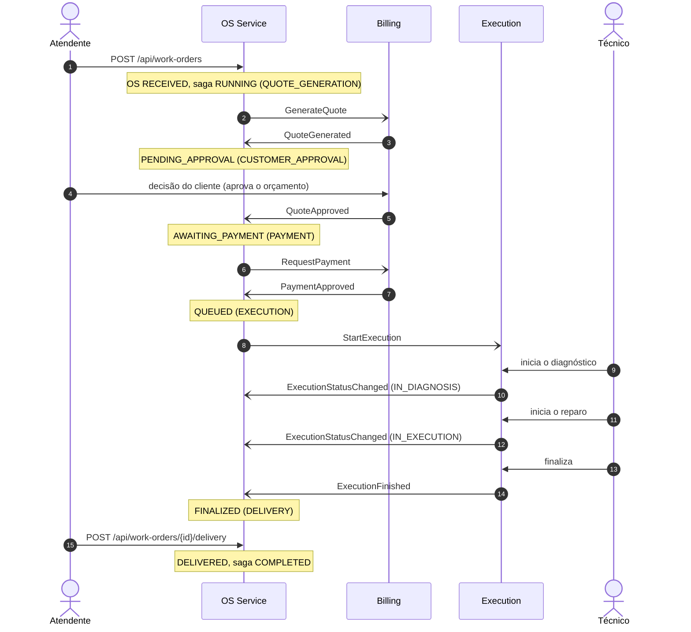
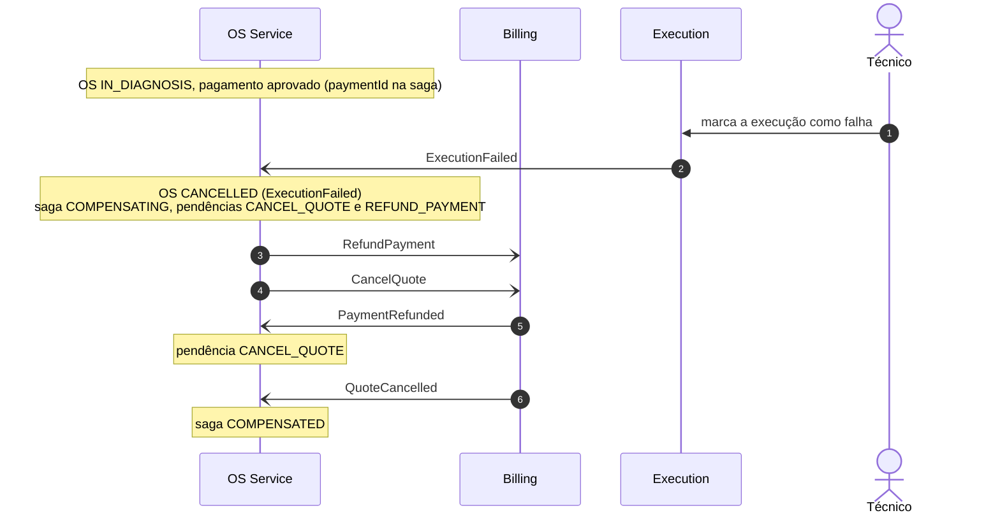

# soat-oficina-os-service

[](https://github.com/DevEgF/soat-oficina-os-service/actions/workflows/ci.yml?query=branch%3Adevelop)
[](https://sonarcloud.io/summary/new_code?id=DevEgF_soat-oficina-os-service)
[](https://sonarcloud.io/summary/new_code?id=DevEgF_soat-oficina-os-service)

Serviço de **Ordens de Serviço (OS)** da oficina mecânica — Tech Challenge SOAT, Fase 4.

## O que é e papel na saga

É um dos três microsserviços que substituem o monólito `soat-oficina-app`; os outros são
`soat-oficina-billing-service` (orçamento e pagamento) e `soat-oficina-execution-service` (execução do
serviço). Este serviço abre a OS, guarda clientes, veículos e o histórico de status, emite o JWT de staff
que vale nos três serviços e **é o orquestrador da saga**: decide, a cada evento do Billing e do
Execution, o próximo comando, e, quando algo falha, cancela a OS e pede ao Billing que desfaça o que já
fez. A seção [Saga](#saga) explica a escolha e o fluxo.

Stack: Kotlin 2.4.10, Spring Boot 4.1.2, Java 17, Gradle 9.4.0 (wrapper); Spring Web, Security
(OAuth2 Resource Server, JWT HS256), Actuator, springdoc 3.1.0; PostgreSQL 16 (JPA + Flyway); RabbitMQ
(Spring AMQP); agente Java do New Relic 9.4.0 na imagem.

## Arquitetura

Camadas, de fora para dentro (detalhes e diagramas em [docs/arquitetura.md](docs/arquitetura.md)):

- **Apresentação** (`presentation`): controllers REST, DTOs e o tratamento de erros (`RestExceptionHandler`).
- **Aplicação** (`application`): casos de uso (`WorkOrderApplicationService`, `CustomerLookupService`), o
  orquestrador da saga (`SagaOrchestrator`), o prazo de aprovação (`ApprovalTimeoutService`), o registro
  do ciclo de vida da saga (`SagaLifecycle`) e as portas de saída `CommandPublisher` e `Tracing`.
- **Domínio** (`domain`): o agregado `WorkOrder` (máquina de estados da OS), `WorkOrderSaga` (estado da
  saga), as causas de cancelamento e compensações, clientes, veículos, CPF/CNPJ e placa, e as portas dos
  repositórios.
- **Infraestrutura e adaptadores** (`infrastructure`): JPA/Flyway, RabbitMQ (consumidor, publicador,
  envelope, topologia, retry), segurança e JWT, o adaptador do New Relic (`NewRelicTracing`), o agendador
  do prazo e o filtro de correlação.

## Como rodar

### Fora do cluster

Pré-requisitos: JDK 17 e Docker. O PostgreSQL `os` (porta 5433) e o RabbitMQ (5672) vêm do
`docker-compose.yml` da plataforma, em `soat-oficina-infra-k8s/local/`:

```bash
docker compose --env-file ../.env.local -f ../soat-oficina-infra-k8s/local/docker-compose.yml up -d rabbitmq postgres-os
./gradlew bootRun
```

O `bootRun` ativa o perfil `local` (ambiente `hml`, segredo JWT de desenvolvimento e as senhas do
`docker-compose.yml`); variáveis de ambiente continuam valendo por cima. A API sobe em
`http://localhost:8081`. No perfil `local` cada usuário de staff tem senha igual ao próprio nome
(`admin`, `atendente`, `tecnico`); fora dos perfis `local` e `test` isso é recusado na subida.

### No kind

O cluster `oficina` (contexto `kind-oficina`), o namespace `oficina`, o RabbitMQ e o Secret
`os-service-secrets` vêm de `soat-oficina-infra-k8s/local/` (`up.sh` e `secrets.sh`).

```bash
scripts/deploy-kind.sh all
curl http://localhost:30081/actuator/health/readiness
```

| Subcomando | O que faz |
|---|---|
| `build` | `docker build` de `soat-oficina-os-service:$IMAGE_TAG` |
| `load` | `kind load docker-image` no cluster `oficina` |
| `apply` | overlay kustomize temporário com a tag e `kubectl apply -k` |
| `wait` | `kubectl rollout status` do banco e do serviço |
| `smoke` | `GET /actuator/health` no NodePort 30081 até `UP` |
| `rollback` | `kubectl rollout undo` + espera (no primeiro deploy só avisa) |
| `diagnose` | pods, eventos, describe e logs |
| `all` | build, load, apply, wait e smoke; se falhar, rollback e diagnóstico |

Variáveis: `IMAGE_TAG` (padrão: SHA curto do `HEAD`, ou `local`), `KIND_CLUSTER=oficina`,
`KUBE_CONTEXT=kind-oficina`, `NAMESPACE=oficina`, `ROLLOUT_TIMEOUT=300s`. Como a tag padrão é o SHA do
`HEAD`, para implantar mudanças ainda não commitadas use outra tag (`IMAGE_TAG=<sha>-teste1
scripts/deploy-kind.sh all`).

No GitHub, o workflow `Deploy` roda o mesmo script no runner self-hosted (`oficina-kind`) depois de um
`CI` verde de push na `main`.

## API

Swagger em `/swagger-ui.html` e OpenAPI em `/v3/api-docs` (públicos). Coleção Postman da plataforma:
[soat-oficina-infra-k8s/postman](https://github.com/DevEgF/soat-oficina-infra-k8s/tree/develop/postman).

Todas em JSON. `/api/**` exige `Authorization: Bearer <jwt>`: HS256 assinado com SHA-256 do
`APP_JWT_SECRET`, `iss=oficina`, `aud=oficina-api` e `env` igual ao `APP_ENVIRONMENT`. Rotas fora de
`/api/**` e das públicas são negadas. Erros no formato `{ "message", "requestId" }`: 400 validação
(inclui CPF/CNPJ e placa inválidos), 401 sem token ou credencial errada, 403 token sem a permissão da
rota, 404 não encontrado, 409 regra de negócio ou transição de status inválida.

| Rota | Quem | O que faz |
|---|---|---|
| `POST /api/public/auth/login` | público | `{ "username", "password" }` → `{ "accessToken", "expiresInSeconds" }`. Usuários `admin` (`ADMIN`), `atendente` (`ATTENDANT`) e `tecnico` (`TECHNICIAN`) |
| `POST /api/work-orders` | autenticado | Abre a OS (`RECEIVED`), cria a saga e publica `GenerateQuote`. Cliente achado por `taxId` e veículo por placa, criados se não existirem; veículo de outro cliente é 409. Pelo menos um item em `services` ou `parts`, só `code` e `quantity` (catálogo e preço são do Billing). 201 |
| `GET /api/work-orders/{id}` | autenticado | OS com cliente, veículo, itens, `quoteId`, `paymentId`, totais em centavos, `cancellationReason` e `saga { status, step, failureReason, pendingCompensations }`; o que ainda não chegou vem `null` (e `pendingCompensations`, `[]`) |
| `GET /api/work-orders/{id}/history` | autenticado | Mudanças de status em ordem cronológica: `fromStatus`, `toStatus`, `reason` (type do evento, `WorkOrderOpened`, `DeliveryRegistered` ou `ApprovalTimeout`), `occurredAt` |
| `POST /api/work-orders/{id}/delivery` | autenticado | Só a partir de `FINALIZED`: leva a `DELIVERED` e conclui a saga (`COMPLETED`) |
| `GET /api/internal/customers/{taxId}` | escopo `INTERNAL` | Consulta do serviço de autenticação de clientes: `{ "id", "status": "ACTIVE" }`. `taxId` é o CPF ou CNPJ só com dígitos (400 se tiver outra coisa ou for inválido), 404 se não houver cliente. Token de staff ou de cliente recebe 403 |
| `GET /api/info` | autenticado | Nome, ambiente e versão do serviço |
| `GET /actuator/health` | público | Também `/actuator/health/liveness` e `/actuator/health/readiness` (banco e RabbitMQ) |

O token da rota interna é emitido pelo próprio serviço de autenticação com o mesmo segredo e as mesmas
regras, `sub=soat-oficina-auth` e `scope=["INTERNAL"]`; nada da consulta (documento, token) vai para log.
Não existe bloqueio de cliente neste serviço, por isso o `status` é sempre `ACTIVE`.

Status da OS: `RECEIVED` (Recebida), `PENDING_APPROVAL` (Aguardando Aprovação), `AWAITING_PAYMENT`
(Aguardando Pagamento), `QUEUED` (Na Fila), `IN_DIAGNOSIS` (Diagnóstico), `IN_EXECUTION` (Execução),
`FINALIZED` (Finalizada), `DELIVERED` (Entregue), `CANCELLED` (Cancelada). Na OS cancelada,
`cancellationReason` é o tipo do gatilho (`QuoteGenerationFailed`, `QuoteRejected`, `PaymentRejected`,
`ExecutionFailed` ou `ApprovalTimeout`); `saga.failureReason` é o texto enviado pelo participante (no
prazo vencido, `Quote not approved within <prazo>`).

## Banco

PostgreSQL próprio (`os`), esquema versionado pelo Flyway em `src/main/resources/db/migration`.

| Tabela | O que guarda |
|---|---|
| `clientes` | Cliente: CPF/CNPJ só com dígitos (único), nome, e-mail e telefone |
| `veiculos` | Veículo de um cliente: placa normalizada (única), marca, modelo e ano |
| `ordens_servico` | A OS: status, código de acompanhamento, totais do orçamento em centavos, instante de cada etapa, motivo do cancelamento e versão (lock otimista) |
| `ordem_servico_linhas_servico` / `ordem_servico_linhas_peca` | Itens pedidos: código do catálogo e quantidade, na ordem |
| `saga_os` | Estado da saga de cada OS (id = id da OS): status, passo, `quote_id`, `payment_id`, `correlation_id`, motivo da falha e compensações pendentes |
| `os_historico` | Uma linha por mudança de status: status anterior e novo, motivo e `message_id` do evento |
| `processed_message` | `messageId` dos eventos já processados (idempotência do consumidor) |

## Mensagens

Exchange topic `oficina` (durável); topologia declarada na subida, idêntica nos três serviços. Cada
fila tem `x-dead-letter-exchange=oficina.dlx` e `x-dead-letter-routing-key=<fila>.dlq`, com a DLQ
`<fila>.dlq` ligada ao exchange direct `oficina.dlx`.

Envelope JSON (sem `__TypeId__`): `messageId`, `sagaId` (id da OS), `type`, `occurredAt`,
`correlationId` (nasce no `X-Correlation-Id` da abertura e se repete em toda a saga) e `payload`.
`messageId` e `type` vão também nas propriedades AMQP, o `correlationId` no cabeçalho `x-correlation-id`
e, com o agente do New Relic ligado, os cabeçalhos de trace `traceparent`, `tracestate` e `newrelic`.

**Publica** (sempre depois do commit):

| type | Routing key | Fila de destino | Quando |
|---|---|---|---|
| `GenerateQuote` | `command.billing.generate-quote` | `billing.commands` | OS aberta |
| `RequestPayment` | `command.billing.request-payment` | `billing.commands` | `QuoteApproved` |
| `StartExecution` | `command.execution.start-execution` | `execution.commands` | `PaymentApproved` |
| `CancelQuote` | `command.billing.cancel-quote` | `billing.commands` | `PaymentRejected`, `ExecutionFailed` ou prazo de aprovação vencido |
| `RefundPayment` | `command.billing.refund-payment` | `billing.commands` | `ExecutionFailed` (publicado antes do `CancelQuote`) |

O `reason` dos comandos de compensação é o tipo do gatilho (`PaymentRejected`, `ExecutionFailed` ou
`ApprovalTimeout`).

**Consome** da fila `os.events` (binding `event.#`):

| type | Routing key | Efeito |
|---|---|---|
| `QuoteGenerated` | `event.billing.quote-generated` | `PENDING_APPROVAL`; guarda `quoteId` e totais |
| `QuoteGenerationFailed` | `event.billing.quote-generation-failed` | `CANCELLED`; saga `COMPENSATED` |
| `QuoteApproved` | `event.billing.quote-approved` | `AWAITING_PAYMENT`; publica `RequestPayment` |
| `QuoteRejected` | `event.billing.quote-rejected` | `CANCELLED`; saga `COMPENSATED` |
| `PaymentApproved` | `event.billing.payment-approved` | `QUEUED`; guarda `paymentId`; publica `StartExecution` |
| `PaymentRejected` | `event.billing.payment-rejected` | `CANCELLED`; publica `CancelQuote`; saga `COMPENSATING` |
| `ExecutionStatusChanged` | `event.execution.status-changed` | `IN_DIAGNOSIS` ou `IN_EXECUTION` |
| `ExecutionFinished` | `event.execution.finished` | `FINALIZED` |
| `ExecutionFailed` | `event.execution.failed` | `CANCELLED`; publica `RefundPayment` e `CancelQuote`; saga `COMPENSATING` |
| `QuoteCancelled` | `event.billing.quote-cancelled` | Baixa a pendência `CANCEL_QUOTE`; sem pendência, saga `COMPENSATED` |
| `PaymentRefunded` | `event.billing.payment-refunded` | Baixa a pendência `REFUND_PAYMENT`; sem pendência, saga `COMPENSATED` |

## Configuração

| Variável | Origem no cluster | Padrão fora do cluster |
|---|---|---|
| `SERVER_PORT` | ConfigMap (`8080`) | `8081` |
| `APP_ENVIRONMENT` | ConfigMap (`hml`) | obrigatório (perfil `local`: `hml`) |
| `APP_JWT_SECRET` | Secret | obrigatório (perfil `local`: segredo de desenvolvimento) |
| `APP_JWT_EXPIRATION_MINUTES` | ConfigMap (`60`) | `60` |
| `APP_SECURITY_ADMIN_PASSWORD` / `_ATTENDANT_` / `_TECHNICIAN_` | Secret | obrigatórias (perfil `local`: ver [Fora do cluster](#fora-do-cluster)) |
| `APP_SAGA_APPROVAL_TIMEOUT` | ConfigMap (`PT30M`) | `PT24H` |
| `APP_SAGA_APPROVAL_CHECK_INTERVAL` | — | `PT30S` |
| `SPRING_DATASOURCE_URL` | ConfigMap (`jdbc:postgresql://os-postgres:5432/os`) | `jdbc:postgresql://localhost:5433/os` |
| `SPRING_DATASOURCE_USERNAME` | ConfigMap (`os`) | `os` |
| `SPRING_DATASOURCE_PASSWORD` | Secret | vazio (perfil `local`: a do `docker-compose.yml`) |
| `SPRING_DATASOURCE_HIKARI_MAXIMUM_POOL_SIZE` | ConfigMap (`4`) | `5` |
| `SPRING_RABBITMQ_HOST` / `_PORT` / `_USERNAME` | ConfigMap (`rabbitmq` / `5672` / `oficina`) | `localhost` / `5672` / `oficina` |
| `SPRING_RABBITMQ_PASSWORD` | Secret | vazio (perfil `local`: a do `docker-compose.yml`) |
| `LOGGING_STRUCTURED_FORMAT_CONSOLE` | ConfigMap (`logstash`: uma linha JSON por log) | texto |
| `NEW_RELIC_APP_NAME` e demais `NEW_RELIC_*` | ConfigMap (`oficina-os-service`) | — |
| `NEW_RELIC_LICENSE_KEY` | Secret (vazio desliga o agente) | — |

Contrato do Secret `os-service-secrets` (modelo só com placeholders em `k8s/secret.example.yaml`, fora
do `kustomization.yaml`):

| Chave | Uso |
|---|---|
| `APP_JWT_SECRET` | segredo HS256 compartilhado entre os serviços (mínimo 32 bytes) |
| `SPRING_DATASOURCE_PASSWORD` | senha da aplicação **e** do PostgreSQL `os-postgres` |
| `SPRING_RABBITMQ_PASSWORD` | senha do usuário `oficina` no RabbitMQ |
| `APP_SECURITY_ADMIN_PASSWORD` | senha do usuário `admin` no login de staff |
| `APP_SECURITY_ATTENDANT_PASSWORD` | senha do usuário `atendente` |
| `APP_SECURITY_TECHNICIAN_PASSWORD` | senha do usuário `tecnico` |
| `NEW_RELIC_LICENSE_KEY` | license key do New Relic; vazio desliga o agente |

## Qualidade

```bash
./gradlew check
```

Roda tudo o que o CI roda: testes unitários (domínio, orquestrador, envelope, adaptadores), testes de
integração (contexto completo contra PostgreSQL e RabbitMQ reais via Testcontainers; precisa do Docker)
e o BDD, e falha se a cobertura de linhas do serviço inteiro ficar abaixo de **80%** (JaCoCo,
`jacocoTestCoverageVerification`). Só a classe principal fica fora da conta, com a mesma exclusão no
Sonar. Relatórios em `build/reports/jacoco/test/` (XML e HTML) e `build/reports/tests/test/`.

**BDD.** `src/test/resources/features/fluxo-os.feature` (Gherkin em português) descreve o caminho feliz
completo e o pagamento recusado com compensação. Os passos (`WorkOrderFlowSteps`) usam a API HTTP do
serviço e simulam o Billing e o Execution publicando os eventos no exchange `oficina` e lendo os comandos
de filas de teste. Roda no `check` pelo JUnit Platform (suíte `WorkOrderFlowFeatureTest` com o motor do
Cucumber); relatório HTML em `build/reports/cucumber/cucumber.html`. Só o BDD:

```bash
./gradlew test --tests '*WorkOrderFlowFeatureTest'
```

**Sonar.** A análise roda pelo CI, não pela análise automática do SonarQube Cloud (o projeto não está
vinculado ao GitHub, então ela não se aplica): o job `ci / build` roda `./gradlew sonar
-Dsonar.qualitygate.wait=true` com o relatório do JaCoCo quando o secret `SONAR_TOKEN` existe, em pull
requests e em push na `main` (projeto `DevEgF_soat-oficina-os-service`, organização
`devegf-soat-oficina`); o plano gratuito do SonarQube Cloud não analisa outras branches, então o push
na `develop` roda testes, gate de cobertura e imagem, sem o Sonar. O badge do CI mostra a `develop`;
os do Sonar, a `main`. O job `ci / image` faz o build da imagem,
sem push.

**Verificação de dependências.** `gradle/verification-metadata.xml` guarda o SHA-256 de tudo o que o
Gradle baixa (plugins, BOMs, bibliotecas, Kotlin, JaCoCo, Testcontainers, Cucumber) para `check`,
`bootJar` e `sonarResolver`; um artefato diferente ou fora da lista quebra o build, inclusive dentro do
`docker build`. Não há verificação de assinatura. Ao mudar uma dependência ou um plugin:

```bash
./gradlew --no-daemon --refresh-dependencies --write-verification-metadata sha256 check bootJar sonarResolver
./gradlew --no-daemon --refresh-dependencies check bootJar sonarResolver
docker build -t soat-oficina-os-service:verificacao .
```

O primeiro comando acrescenta os checksums novos (o `--refresh-dependencies` faz o Gradle baixar de novo
os metadados que estariam só no cache); revise o diff do arquivo, tire entradas de versões que saíram e
confirme com os outros dois.

## Observabilidade

New Relic, aplicação **`oficina-os-service`** (`NEW_RELIC_APP_NAME`). O agente Java 9.4.0 vai na imagem e
só liga quando `NEW_RELIC_LICENSE_KEY` não está vazio. O código fala com o agente por um adaptador só,
`NewRelicTracing` (porta `Tracing`); sem o agente a API é no-op.

**Trace distribuído pelo RabbitMQ.** Comandos publicados durante uma requisição HTTP já saem com
`traceparent`, `tracestate` e `newrelic`. No consumo, cada mensagem de `os.events` (e cada nova
tentativa) é uma transação do agente, `Message/os.events/<type>`, que antes de tudo aceita os cabeçalhos
de trace da mensagem; assim o comando publicado a partir de um evento (por exemplo `RequestPayment`
depois de `QuoteApproved`) continua o mesmo trace. Atributos da transação: `sagaId`, `messageType`,
`messageId` e `correlationId`. Cada execução da verificação do prazo de aprovação é a transação
`Job/ApprovalTimeoutCheck`.

**Logs.** Uma linha JSON por log no stdout (formato logstash). O agente encaminha os logs ao New Relic
com o MDC (`NEW_RELIC_APPLICATION_LOGGING_FORWARDING_CONTEXT_DATA_ENABLED=true`): `requestId` (o
correlation id), `environment` e `service` nas requisições; `requestId`, `sagaId`, `messageType` e
`messageId` enquanto uma mensagem é processada. O ciclo de vida da saga tem uma linha por evento, com as
chaves `sagaId`, `step`, `fromStatus`, `toStatus`, `trigger`, `sagaStatus` e, no fim, `durationMs`:
`saga.started`, `saga.step.completed`, `saga.compensation.started`, `saga.compensation.confirmed`,
`saga.compensated` e `saga.completed`.

**Eventos personalizados** (usados pelo dashboard da saga; sem dado pessoal):

| Evento | Quando | Atributos |
|---|---|---|
| `SagaTransition` | Cada mudança aplicada na saga (abertura, evento, entrega, prazo vencido) | `sagaId`, `fromStatus` (vazio na abertura), `toStatus`, `trigger` (type do evento, `WorkOrderOpened`, `DeliveryRegistered` ou `ApprovalTimeout`), `sagaStatus` |
| `SagaFinished` | A saga chega a `COMPLETED` ou `COMPENSATED` | `sagaId`, `outcome`, `durationMs` (da abertura da OS ao fim da saga), `cancellationReason` (vazio quando `COMPLETED`) |

Exemplos de NRQL: `SELECT count(*) FROM SagaFinished FACET outcome SINCE 1 day ago` e
`SELECT average(durationMs) FROM SagaFinished WHERE outcome = 'COMPLETED' TIMESERIES`.

Dados pessoais ficam fora: `request.uri` (a rota interna leva o CPF/CNPJ no caminho), parâmetros e
cabeçalhos HTTP estão em `NEW_RELIC_ATTRIBUTES_EXCLUDE`, e os logs não registram documento, e-mail nem
token.

## Saga

### Escolha: orquestração

O OS Service orquestra a saga; Billing e Execution só recebem comandos e respondem com eventos.

- O agregado `WorkOrder` já era uma máquina de estados explícita (cada transição valida o status de
  origem) e virou o estado da saga: `WorkOrderSaga` acompanha o status da OS e guarda o que os
  participantes devolveram (`quoteId`, `paymentId`).
- As compensações ficam em um só lugar (`SagaOrchestrator` e `CancellationCause`) e dependem de um só
  estado: o que desfazer sai do status em que a OS estava e do que a saga sabe que foi feito.
- O andamento de cada OS é consultável: `saga_os` tem status, passo, motivo da falha e pendências, e
  `os_historico` tem cada transição com o evento que a causou (`GET /api/work-orders/{id}` e `/history`).
- Os participantes não conhecem uns aos outros, só o contrato de mensagens com o orquestrador.

Coreografia foi descartada porque espalharia a regra de compensação pelos três serviços (cada um teria de
saber o que os outros já fizeram) e exigiria reconstruir o estado da OS a partir dos eventos de todos.

**Custos assumidos:** o orquestrador concentra a lógica do fluxo e é ponto de acoplamento (mudar o fluxo
é mudar este serviço); não há outbox, então uma falha ao publicar depois do commit deixa a saga parada
naquele passo (fica o log `message.publish.failed`; limitação registrada); entre os serviços a
consistência é eventual.

### Passos

| Passo (`saga.step`) | Dono | Sucesso | Falha | Compensação |
|---|---|---|---|---|
| `QUOTE_GENERATION` | Billing (`GenerateQuote`) | `QuoteGenerated`: OS `PENDING_APPROVAL` | `QuoteGenerationFailed`: OS `CANCELLED` | nenhuma (nada foi criado) |
| `CUSTOMER_APPROVAL` | Billing, com a decisão do cliente | `QuoteApproved`: OS `AWAITING_PAYMENT`, publica `RequestPayment` | `QuoteRejected` ou prazo vencido (`ApprovalTimeout`): OS `CANCELLED` | recusa: nenhuma (o Billing já fechou o orçamento); prazo: `CancelQuote` |
| `PAYMENT` | Billing (`RequestPayment`) | `PaymentApproved`: OS `QUEUED`, publica `StartExecution` | `PaymentRejected`: OS `CANCELLED` | `CancelQuote` |
| `EXECUTION` | Execution (`StartExecution`) | `ExecutionStatusChanged` (`IN_DIAGNOSIS`, `IN_EXECUTION`) e `ExecutionFinished`: OS `FINALIZED` | `ExecutionFailed` (de `QUEUED`, `IN_DIAGNOSIS` ou `IN_EXECUTION`): OS `CANCELLED` | `RefundPayment` e `CancelQuote` |
| `DELIVERY` | OS Service (`POST /api/work-orders/{id}/delivery`) | OS `DELIVERED`, saga `COMPLETED` | — | — |

### Compensações

| Gatilho | Status de origem | Comandos (nesta ordem) | Estado final da saga |
|---|---|---|---|
| `QuoteGenerationFailed` | `RECEIVED` | — | `COMPENSATED` na hora |
| `QuoteRejected` | `PENDING_APPROVAL` | — | `COMPENSATED` na hora |
| `ApprovalTimeout` (prazo vencido) | `PENDING_APPROVAL` | `CancelQuote` | `COMPENSATING`; `COMPENSATED` com `QuoteCancelled` |
| `PaymentRejected` | `AWAITING_PAYMENT` | `CancelQuote` | `COMPENSATING`; `COMPENSATED` com `QuoteCancelled` |
| `ExecutionFailed` | `QUEUED`, `IN_DIAGNOSIS`, `IN_EXECUTION` | `RefundPayment`, `CancelQuote` | `COMPENSATING`; `COMPENSATED` com `PaymentRefunded` e `QuoteCancelled`, em qualquer ordem |

Em todos os casos a OS vai para `CANCELLED` com `cancellationReason` igual ao gatilho, e o passo da saga
fica onde ela parou. Só se desfaz o que o participante de fato fez (um orçamento ou um pagamento que a
saga conhece). Enquanto a saga está em `COMPENSATING`, `saga.pendingCompensations` lista o que o Billing
ainda não confirmou (`CANCEL_QUOTE`, `REFUND_PAYMENT`).

### Caminho feliz



### Compensação: falha na execução com estorno



### Garantias

- **Idempotência por `messageId`:** o `messageId` do evento é gravado em `processed_message` na mesma
  transação do efeito; a mesma mensagem de novo é confirmada (ack) sem efeito.
- **Publicação depois do commit:** OS, saga, histórico e `messageId` são gravados juntos e os comandos
  só saem depois do commit (`AfterCommitPublisher`); um rollback nunca vaza comando.
- **Ordem e concorrência:** a linha da saga é travada (`SELECT ... FOR UPDATE`) enquanto um evento ou o
  prazo é aplicado, então duas confirmações (ou um evento e o prazo) nunca se sobrescrevem. Evento que
  não se aplica ao status atual (fora de ordem, de outro orçamento ou pagamento, ou depois do
  cancelamento) é descartado com log `WARN`, sem mudar nada.
- **Retry e DLQ:** falha no processamento tem 3 tentativas (500 ms, depois 1 s) e vai para
  `os.events.dlq`; JSON inválido, `type` fora do contrato ou payload inválido vão direto para a DLQ.
- **Prazo de aprovação:** a cada `APP_SAGA_APPROVAL_CHECK_INTERVAL` (padrão `PT30S`) o serviço cancela as
  OS que estão em `PENDING_APPROVAL` há mais que `APP_SAGA_APPROVAL_TIMEOUT` (padrão `PT24H`; `PT30M` no
  kind), contado da entrada no status, e publica `CancelQuote`. Cada OS é cancelada na sua própria
  transação; um erro em uma não impede as outras, e uma aprovação que chegou antes vence.

## Proteção da `main`

`scripts/configure-github.sh` aplica, via GitHub CLI, o ruleset `soat-protection-main` (pull request
obrigatório, checks `ci / build` e `ci / image` obrigatórios, sem force-push e sem deleção), exige
aprovação para workflows de PRs de fork e grava o secret `SONAR_TOKEN` quando a variável está no
ambiente. O deploy (`deploy / kind`) só roda depois de um CI verde de push na `main`, em runner
self-hosted registrado por `local/runners.sh` do repositório `soat-oficina-infra-k8s`.
