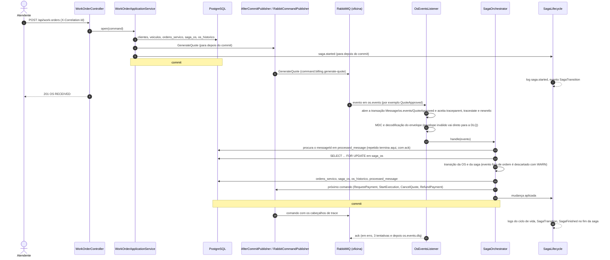
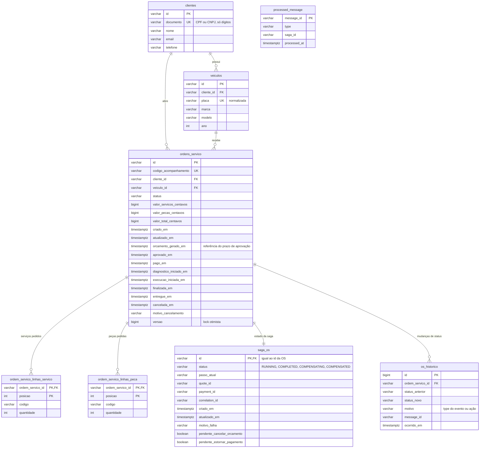

# Arquitetura do OS Service

O serviço segue camadas com dependência de fora para dentro: a apresentação chama a aplicação, a
aplicação usa o domínio e fala com o mundo por portas (interfaces), e a infraestrutura implementa essas
portas (banco, RabbitMQ, New Relic, segurança). O domínio não conhece Spring, JPA nem RabbitMQ. O papel do
serviço na saga entre os três microsserviços está no [README](../README.md#saga).

## Componentes por camada

```mermaid
flowchart TB
    subgraph apresentacao["Apresentação (presentation)"]
        WOC["WorkOrderController<br/>/api/work-orders"]
        AUC["AuthController<br/>/api/public/auth/login"]
        ICC["InternalCustomerController<br/>/api/internal/customers/{taxId}"]
        INF["InfoController<br/>/api/info"]
        REH["RestExceptionHandler"]
    end

    subgraph aplicacao["Aplicação (application)"]
        WOAS["WorkOrderApplicationService<br/>abre, consulta, entrega"]
        CLS["CustomerLookupService"]
        SO["SagaOrchestrator<br/>eventos, transições, próximos comandos"]
        ATS["ApprovalTimeoutService"]
        SL["SagaLifecycle<br/>logs do ciclo de vida, SagaTransition, SagaFinished"]
        ACP["AfterCommitPublisher"]
        SC["SagaCommands"]
        CP[["CommandPublisher (porta)"]]
        TR[["Tracing (porta)"]]
    end

    subgraph dominio["Domínio (domain)"]
        WO["WorkOrder<br/>máquina de estados da OS"]
        WOS["WorkOrderSaga<br/>status, passo, pendências"]
        CC["CancellationCause, Compensation"]
        VO["Customer, Vehicle, TaxDocument, LicensePlate"]
        RP[["Portas: repositórios, TokenIssuerPort"]]
    end

    subgraph infra["Infraestrutura e adaptadores (infrastructure)"]
        JPA["RepositoryAdapters + JPA"]
        OEL["OsEventsListener"]
        RCP["RabbitCommandPublisher"]
        EC["EnvelopeCodec"]
        TOP["MessagingTopology, ListenerRetryConfiguration"]
        SEC["SecurityConfiguration, JwtConfiguration"]
        JIS["JwtIssuerService"]
        NRT["NewRelicTracing"]
        SCH["ApprovalTimeoutScheduler"]
        CIF["CorrelationIdFilter"]
    end

    PG[("PostgreSQL os")]
    MQ[("RabbitMQ<br/>exchange oficina")]
    NR[("New Relic")]

    WOC --> WOAS
    ICC --> CLS
    AUC --> JIS
    WOAS --> SC
    WOAS --> ACP
    WOAS --> SL
    SO --> SC
    SO --> ACP
    SO --> SL
    ATS --> SO
    ACP --> CP
    SL --> TR
    WOAS --> WO
    WOAS --> WOS
    SO --> WO
    SO --> WOS
    SO --> CC
    CLS --> VO
    WOAS --> RP
    SO --> RP
    CLS --> RP

    JPA -. implementa .-> RP
    JIS -. implementa .-> RP
    RCP -. implementa .-> CP
    NRT -. implementa .-> TR
    OEL --> EC
    OEL --> SO
    OEL --> TR
    SCH --> ATS
    SCH --> TR
    RCP --> EC
    JPA --> PG
    RCP --> MQ
    MQ --> OEL
    TOP --> MQ
    NRT --> NR
    SEC -. valida o JWT .-> apresentacao
    CIF -. requestId no MDC .-> apresentacao
```

- **Apresentação:** valida a entrada (Bean Validation), converte DTOs e mapeia exceções para status HTTP.
  A rota interna só aceita o token com escopo `INTERNAL` (regra em `SecurityConfiguration`).
- **Aplicação:** cada caso de uso é uma transação. Comandos para os outros serviços são registrados no
  `AfterCommitPublisher` e só saem depois do commit; o `SagaLifecycle` também escreve depois do commit.
- **Domínio:** `WorkOrder` valida cada transição pelo status de origem; `WorkOrderSaga` segue o status da
  OS e, depois de uma falha, guarda as compensações pendentes; `CancellationCause` diz de que status cada
  falha pode vir e o que tem de ser desfeito.
- **Infraestrutura:** o consumidor `OsEventsListener` abre a transação do agente do New Relic, aceita os
  cabeçalhos de trace da mensagem, põe `requestId`, `sagaId`, `messageType` e `messageId` no MDC, decodifica
  o envelope e chama o orquestrador. `NewRelicTracing` é o único ponto que usa a API do New Relic.

## Participação na saga

Abertura da OS pela API e processamento de um evento do Billing ou do Execution, por dentro do serviço.

O prazo de aprovação segue o mesmo caminho a partir do `ApprovalTimeoutScheduler` (transação
`Job/ApprovalTimeoutCheck`): `ApprovalTimeoutService` busca as OS vencidas e chama
`SagaOrchestrator.expireApproval` para cada uma, em transações separadas.

## Modelo de dados

`processed_message` não tem chave estrangeira: um evento de uma OS desconhecida também é registrado, para
não ser processado de novo. As migrations ficam em `src/main/resources/db/migration` (`V1__init.sql` e
`V2__compensacoes_saga.sql`); uma mudança de esquema entra em uma migration nova.
